# Kohana 4 "renatus"

**Kohana - small, explicit, and finally current.**

Kohana 4 is an HMVC framework in the tradition of Kohana 3.3 and Koseven: strict object orientation, the cascading filesystem, transparent class extension (`class Arr extends Kohana_Arr {}`), modules, and no magic you cannot read in an afternoon. This version brings that style to PHP 8.4 and later.

Version 4.0.0 is called **renatus**: a first name of Latin origin which means "born again" ("natus" = "born").

- [What this project is](#what-this-project-is)
- [Getting started](#getting-started)
- [What is in it](#what-is-in-it)
- [Upgrading from Kohana 3.3 or Koseven](#upgrading-from-kohana-33-or-koseven)
- [The rules it is built by](#the-rules-it-is-built-by)
- [How it was written](#how-it-was-written)
- [Thank you](#thank-you)
- [License and links](#license-and-links)

## What this project is

**A personal project.** It is developed by one person, for the applications that person maintains, and shared for whoever finds it useful. There is no team behind it and no promise of support.

**It keeps the Kohana style alive on modern PHP.** It does not try to keep old applications running unchanged. That is the difference from [Konine](https://github.com/hospicedev/konine), which starts from the same code:

| | Konine | Kohana 4 "renatus" |
|---|---|---|
| First duty | Existing Kohana and Koseven applications keep working without changes | The framework is right for current PHP, even when old code has to change |
| Changes that break old code | Avoided; new behaviour is opt-in | Made when they make the framework simpler, safer or more correct, and listed |
| A drop-in replacement? | Yes, that is the point | No: an application is [upgraded](#upgrading-from-kohana-33-or-koseven) |
| Version | 3.4.x | 4.0.0 |

If you want an existing application to run on PHP 8.4 with as little work as possible, use Konine. If you like how Kohana works and want to write new code with it, or are willing to bring an application up to date, this project is for that.

**It stays small.** Kohana 4 will not become a large, full-featured, all-in-one framework; there are good ones already. The heart of Kohana still beats here: a small core you can read, classes you extend in the open, and nothing that works in a way you cannot follow.

**It moves with PHP.** Development is rolling: each new PHP version is taken up as it comes, its features are used where they make the code simpler or safer, and what PHP deprecates is removed in good time. Many small steps, so that there is never again a long silence followed by one large jump.

## Getting started

You need PHP 8.4 or later with the `mbstring` and `intl` extensions, and a web server that points at the `public/` directory. Everything else is optional and only needed by the module that uses it: a database (MySQL, MariaDB, PostgreSQL or SQLite), `curl`, `gd` or `imagick`, `openssl` or `sodium`, Redis, Memcached, APCu.

1. Put the code on your server and point the web server at `public/`.
2. Open the site: the install page checks your environment. Delete `public/install.php` when it passes.
3. Set up `application/bootstrap.php`: the time zone, the cookie salt, the modules you use.
4. Check the result from the command line:

```bash
./minion check
```

**Where to read on.** How to install and how to use the framework is in the guide, which is part of the code, in `system/guide/` and in the `guide/` directory of each module:

- [Installation](system/guide/kohana/install.md), with every step
- [Hello, world](system/guide/kohana/tutorials/hello-world.md), your first page
- [A Model from Start to End](system/guide/kohana/tutorials/model.md), a complete feature

Enable the `userguide` module to read it in your own site at `/guide`, with search and an API browser. It is off in production.

## What is in it

### The core

`system/` holds the framework: requests and responses, routing, controllers, views, validation, sessions, cookies, security helpers, logging, the profiler, and the helpers for arrays, text, dates, files, HTML and forms.

New in 4.0, in short (the full list is in [CHANGELOG.md](CHANGELOG.md)):

- **Types on everything**: every method, property and constant.
- **Safe defaults**: prepared statements, SHA-256 signatures, a CSRF field, security headers, a Content-Security-Policy nonce, and a production error page that shows a reference code and nothing else.
- **Tools**: `./minion check`, a readable error page, logs as JSON, rate limiting, CORS, archives, CSV and XML responses, a full client for requests to other servers.

### Modules

Enabled one by one in `application/bootstrap.php`; a module that is not enabled costs nothing.

| Module | Does |
|---|---|
| `auth` | Logins, with users in a file or in the database |
| `cache` | File, SQLite, APCu, Memcached and Redis caches behind the same methods |
| `codebench` | Compares the speed of pieces of code |
| `database` | Connections and the query builder: MySQL, MariaDB, PostgreSQL, SQLite |
| `encrypt` | Encryption with OpenSSL or Sodium |
| `image` | Resizing, cropping and converting images with GD or Imagick |
| `migration` **new** | Changes to the database as files, applied in order; seed data |
| `minion` | Tasks for the command line |
| `orm` | Models: finding, saving, relationships, validation |
| `pagination` | Long lists over several pages |
| `unittest` | PHPUnit set up for the framework and your application |
| `userguide` | The documentation and the API browser, in your own site |
| `ko7` **new** | The class names of Koseven (`KO7_*`) as aliases, for code that still uses them |
| `ko9` **new** | The same for the `KO9_*` class names |

Modules that are not part of the core (a debug bar, file storage, a log reader, settings in the database, loading libraries of others) have a repository of their own.

### Themes

Everything the framework prints (error pages, the profiler, the guide, Codebench, the install page) uses one set of colours. There are eight themes, each with a light and a dark side, and a button on every page that switches between the two:

```php
// application/config/theme.php
return ['theme' => 'dracula', 'mode' => 'dark'];
```

**default**

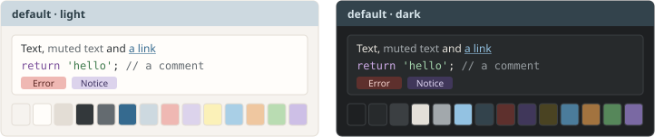

**catppuccin**

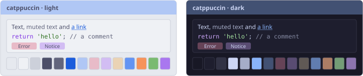

**dracula**

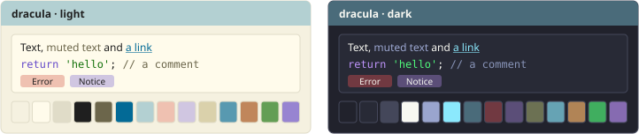

**nord**

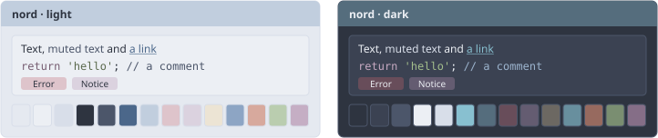

**solarized**

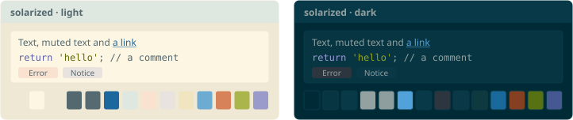

**gruvbox**

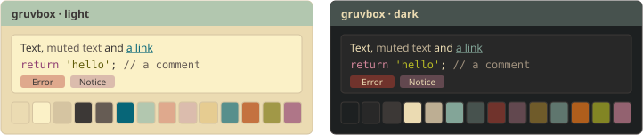

**tokyo-night**

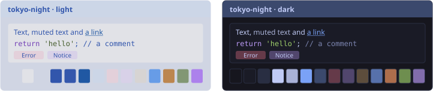

**one**

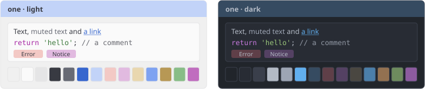

Single colours, the fonts and the corners can be changed too: see [Themes](system/guide/kohana/theme.md) in the guide.

The default theme on what the framework prints:

| | |
|---|---|
| **The error page, in development** 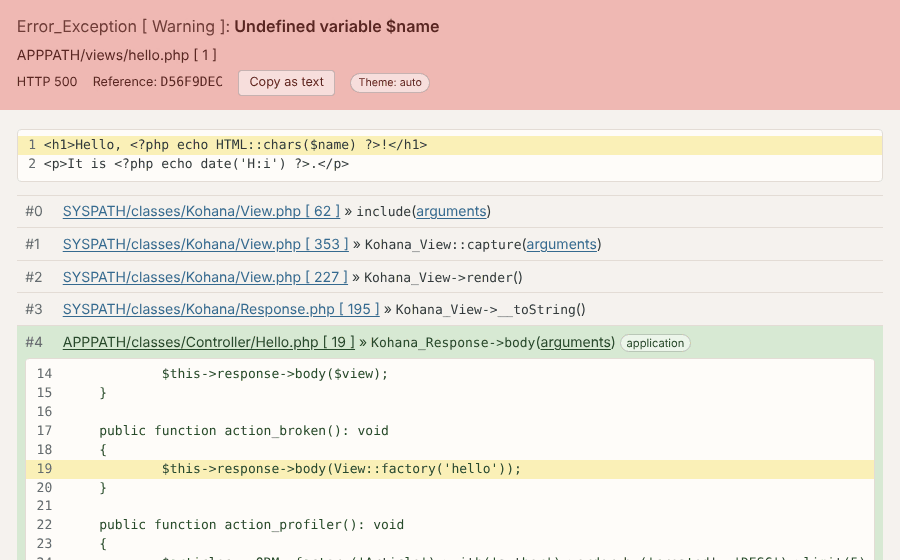 | **The profiler** 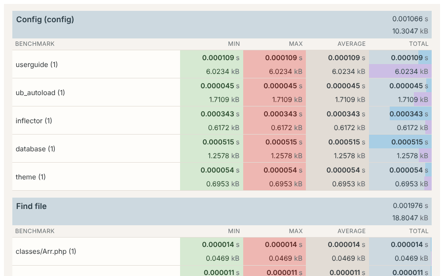 |
| **The user guide** 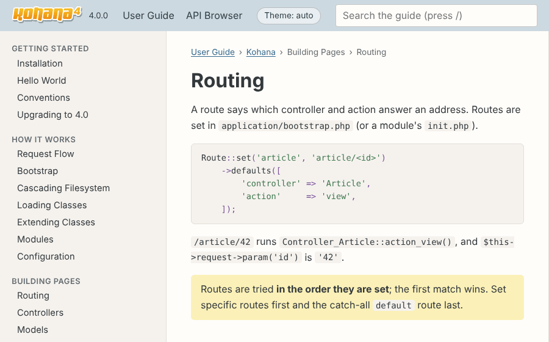 | **The API browser** 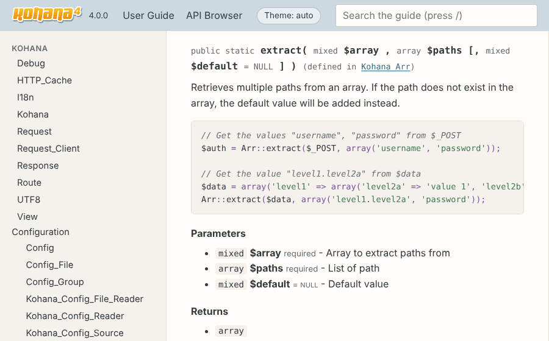 |
| **Codebench** 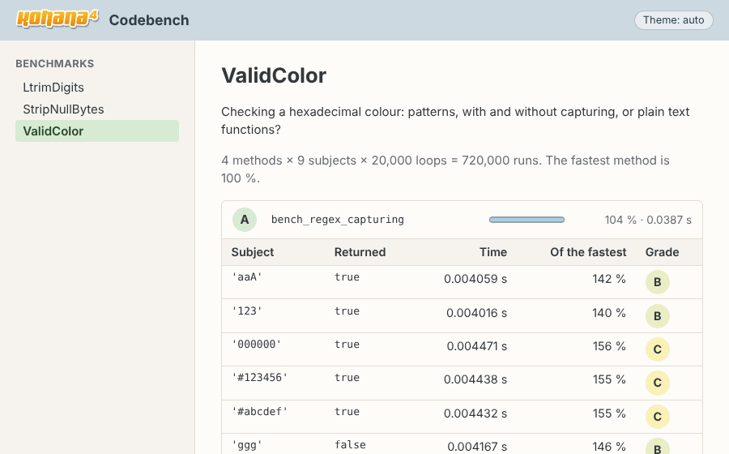 | **The install page** 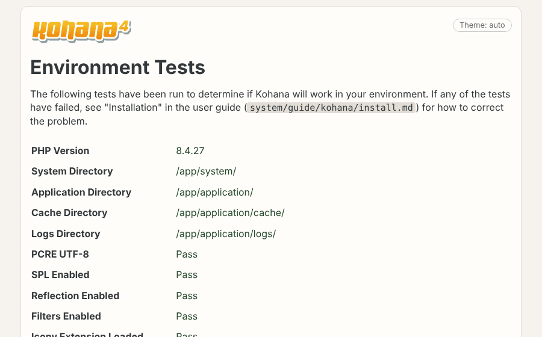 |

## Upgrading from Kohana 3.3 or Koseven

**Kohana 4 is not a drop-in replacement, and that is good news for your code.**

Every breaking change is there to make an application faster, safer or easier to read, and making it does the same for your own code. Adding types is the best example: PHP names each line to change, and afterwards a whole class of mistakes is found before a visitor ever sees it. Take the upgrade as a chance to bring an application up to date, one step at a time, with your tests and `./minion check` telling you where you stand.

The changes most applications meet:

1. **PHP 8.4** is the minimum, with `mbstring` and `intl`.
2. **Class names are `Kohana_*` again.** Coming from Koseven, rename `KO7` to `Kohana`, or enable the `ko7` module.
3. **Types.** A class of yours that extends the framework declares the same types: `public function before(): void`, `protected array $_has_many`, `public function rules(): array`.
4. **Old cookies, sessions and cache entries are not read**: signatures and keys use SHA-256 now. Visitors are logged out once. Passwords keep working and are stored with `password_hash()` at the next login.
5. **Safer defaults that can change behaviour**: prepared statements, checked query operators, `HttpOnly` and `SameSite=Lax` cookies, forwarding headers trusted only from listed proxies, uploads of `.php` and similar files refused.
6. **Errors in production** show a general message and a reference code only.
7. **Deprecations do not stop a request**: they are logged, and listed at the bottom of the page in development.
8. **Removed**: the Mcrypt engine, the MySQL (non-MySQLi) driver, the APC, Memcache and Wincache cache drivers, the client for the PECL `http` extension.
9. **Tests** run on PHPUnit 13: attributes in place of annotations, static data providers.

What to do about each one is in the guide: [Upgrading to 4.0](system/guide/kohana/upgrading.md). Every change, by area, is in [CHANGELOG.md](CHANGELOG.md).

## The rules it is built by

These were set at the start and held throughout. They also say what to expect from future versions.

**The code**

1. Simple, fast and secure. The questions asked of every change: is it simple, is it safe, is it correct?
2. Every method, property and constant has its types. Types are accurate, even when old application code has to change for them.
3. Everything is commented, in plain words, and easy to maintain. Functions that do too much are split.
4. The public API of Kohana 3.3 is kept wherever it can be; where a name changes, the old one stays as an alias.
5. The core keeps the `Kohana_` prefix.
6. No `declare(strict_types=1)`: the framework's own types and checks do that work.
7. Tabs for indentation; `true`, `false` and `null` in lowercase.

**What gets added**

8. A new feature is discussed before it is written.
9. **The core gets something new only when it fills a concrete need** and the result is still simple, safe and easy to read. "It would be nice to have" is not enough.
10. **A new module is written when the same code keeps being repeated** in applications and can be put behind a small, clear set of methods, with the same simplicity and safety as the rest.
11. **No dependence on libraries of others.** The framework runs without Composer, which only installs the development tools. A library is added by a module, or loaded beside the framework.
12. Left out on purpose: `.env` files, a Composer or PSR bridge, two-factor authentication and login throttling in the auth module. Each can be a module.

**Security**

13. Safe by default; less safe behaviour must be asked for.
14. In production, nothing about the error, the configuration or the framework reaches a visitor. The full error is in the log, under the reference code the visitor saw.
15. Development tools (guide, Codebench) do nothing in production. What shows data to a developer hides passwords, tokens and keys.
16. What the framework prints works under a strict Content-Security-Policy: no inline handlers, no style attributes.

**Quality**

17. Every change comes with tests, and every bug that was found with a test that fails without the fix. Today that is about 3,400 tests, run against real MariaDB, PostgreSQL, Redis and Memcached servers, covering about 90% of the lines.
18. One command runs every check, the same one the CI runs: syntax, code style, types, class loading, static analysis at the strictest level, and the tests.

```bash
docker compose -f docker/compose.yml run --rm php docker/check.sh
```

## How it was written

Much of the code of this version was improved over the past five years, by hand, in the applications it runs. For this version all of it was reorganized and improved with the help of AI models: **Claude Fable 5.2** by Anthropic, **DeepSeek-V4**, and open models from Hugging Face: **Omni**, **Qwen3**, **GLM-5.2** and **Mistral**.

**All of it was supervised by humans**: every feature was discussed and decided before it was written, the code was reviewed, and it was tested in real applications, not only by its own tests.

Version 4.0.0 is released on 15 November 2026. What is planned after it is in [TODO.md](TODO.md).

## Thank you

This project stands on nearly two decades of work by other people.

- **CodeIgniter**, by EllisLab, showed what a small, fast and clear PHP framework looks like. Kohana began as a fork of it.
- **Kohana** took that further: strict object orientation, HMVC, the cascading filesystem, transparent extension. Thank you to everyone who wrote, maintained and documented it.
- **Koseven** kept Kohana alive through PHP 7 and into PHP 8 after the original project ended. The code of this project starts there.
- **Konine** carries that code forward for the applications that depend on it, and is where to go when those applications must keep running as they are.

## License and links

[BSD-3-Clause](LICENSE.md), as Kohana and Koseven before it. It can be used for open source, commercial and personal projects.

- This project: https://github.com/uBizzy/kohana4
- Questions, bugs and security problems: https://github.com/uBizzy/kohana4/issues (see [SECURITY.md](SECURITY.md))
- Konine: https://github.com/hospicedev/konine
- Extra modules: to be added
- The logo and the icon in seven colours, as SVG and PNG: `system/media/guide/kohana/logo/`
